<!-- Header Banner -->

  

 

&nbsp;
&nbsp;
&nbsp;

---

## 👨‍💻 About Me

> **Solutions Architect** certified at architect level on **AWS**, **Azure**, and **Google Cloud**. I build production-grade infrastructure & security from bare metal to Kubernetes, with AI integration and full-stack IaC automation. Everything is code, nothing is manual.

- 🌍 Based in the **Greater Toronto Area, Canada**
- ☁️ **Triple-Cloud Architect** — AWS Solutions Architect Professional · Azure Solutions Architect Expert · Google Professional Cloud Architect
- 🤖 **AI Platform Builder** — Claude Certified Architect; self-hosted LLM agents with 17 MCP tool servers behind an open-source AI gateway
- 🏗️ I build and operate a **35+ guest homelab** spanning Proxmox VE, a 7-node Talos Kubernetes cluster, and a GPU worker for local inference
- 🔒 Zero secrets in code · Zero SSH · Zero trust — security-first architecture everywhere
- 🧊 Immutable infrastructure advocate — **Talos Linux** for K8s, **Fedora CoreOS** for AI workloads
- 📱 **Unified Endpoint Management Expert** — enterprise MDM across Apple, Android, Samsung, and Windows
- 🌐 Bilingual — fluent in **English** and **Spanish**

---

## 🔭 Recently Shipped

| When | What |
|:-----|:-----|
| Oct 2026 | 🎓 **Claude Certified Architect – Professional** (Anthropic) |
| Oct 2026 | 🤖 Moved 17 MCP tool servers into Kubernetes behind **agentgateway**, with per-tool access control and human approval for actions |
| Oct 2026 | 🎮 Added an **NVIDIA RTX A1000 GPU worker** to the Talos cluster for local LLM inference |
| Sep 2026 | 🎓 **AWS Certified Solutions Architect – Professional** |
| Jul 2026 | 🎓 **Azure Solutions Architect Expert** · **Google Cloud Generative AI Leader** |
| May 2026 | 🎓 **Azure Administrator Associate** |

---

## 🚀 Featured Projects

<table>
<tr>
<td width="50%" valign="top">

### [☸️ k8s-homelab](https://github.com/Rodiel-Lezcano/k8s-homelab)
**Production-Grade Kubernetes on Proxmox**

7-node HA cluster on Talos Linux, managed by Sidero Omni — immutable OS, eBPF networking, GitOps delivery, a GPU worker for local AI, and multi-layer disaster recovery.

  
  
  
  

`Zero SSH` · `19 Network Policies` · `3-Replica Storage` · `Velero DR`

**Stack:** Cilium · Longhorn · Rancher · Traefik · agentgateway · Fleet GitOps · Velero · Prometheus · Grafana · cert-manager

</td>
<td width="50%" valign="top">

### [🏗️ infraops](https://github.com/Rodiel-Lezcano/infraops)
**Enterprise-Grade IaC for Proxmox Homelab**

Full lifecycle infrastructure automation — Terraform provisioning, Ansible config management, Vault secrets, Jenkins CI/CD, dual-SIEM security operations with IDS and crowd-sourced threat blocking.

  
  
  

`35+ Guests` · `5 TF Modules` · `2-Min VM Deploy` · `Zero Secrets in Code`

**Stack:** Proxmox · Jenkins · Gitea · Semaphore · Wazuh · Splunk · Suricata · CrowdSec · Authentik · Headscale · NetBox · n8n

</td>
</tr>
<tr>
<td width="50%" valign="top">

### [🦞 openclaw](https://github.com/Rodiel-Lezcano/openclaw)
**Self-Hosted AI Agent Platform**

Four Telegram agents on Fedora CoreOS — local-first LLM inference on a GPU, semantic long-term memory, read-only MCP tools behind an AI gateway, and a human approval step before any action.

  
  
  

`4 Agents` · `17 MCP Servers` · `768-dim Vector Memory` · `27+ Agent Skills`

**Stack:** Docker · Ollama · Qdrant · agentgateway · Vault · Prometheus · Grafana · Wazuh

</td>
<td width="50%" valign="top">

### ☁️ AWS Labs

**[aws-serverless-lab](https://github.com/Rodiel-Lezcano/aws-serverless-lab)** — Complete serverless CRUD API using Lambda, API Gateway, and DynamoDB

**[aws-bedrock-genai-workshop](https://github.com/Rodiel-Lezcano/aws-bedrock-genai-workshop)** — No-code GenAI RAG workflow using Amazon Bedrock, OpenSearch, and S3

  
  
  

</td>
</tr>
</table>

---

## 📊 Infrastructure at a Glance

| Metric | Value |
|:-------|:------|
| 🖥️ **Proxmox Guests** | 35+ (LXC containers, VMs, Talos nodes) |
| ☸️ **Kubernetes Nodes** | 7 (3 CP + 3 Worker + 1 GPU) — Talos Linux via Omni |
| 🧱 **Terraform Modules** | 5 production-ready, reusable |
| 🛡️ **Security Stack** | Wazuh EDR · Suricata IDS · CrowdSec · Splunk |
| 🔐 **Network Policies** | 19 CiliumNetworkPolicies |
| 📈 **Prometheus Rules** | 18 alerting rules, 10 ServiceMonitors |
| 🤖 **AI Agents** | 4 agents · 17 MCP servers · 27+ skills |
| 📚 **Documentation** | 700KB+ across 29 guides |

---

## 🛠️ Tech Stack

**Infrastructure & Orchestration**

  
  
  
  
  
  

**Networking & Security**

  
  
  
  
  

**Observability & Monitoring**

  
  
  
  
  

**CI/CD & GitOps**

  
  
  
  

**Cloud & AI**

  
  
  
  
  
  
  

**Operating Systems & Platforms**

  
  
  
  
  

---

## 🏆 Certifications

  Click a badge to verify it on Credly or Microsoft Learn · hover for the full name

<strong>☁️ Cloud Architecture (3)</strong>

 

  <a href="https://www.credly.com/badges/c4892207-9a83-4627-9dea-d82cda72e8e1/public_url">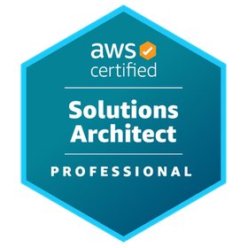</a>
  
  <a href="https://www.credly.com/badges/8f62d4f7-4631-4a40-a626-cbb30f17fafd/public_url">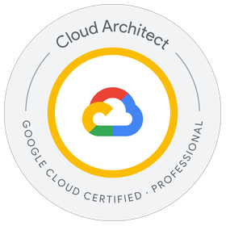</a>

 

<strong>🤖 AI & Machine Learning (4)</strong>

 

  
  <a href="https://www.credly.com/badges/3c4604cb-2c30-4076-a437-a59b3169fcb0/public_url">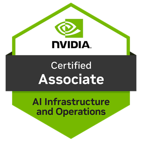</a>
  <a href="https://www.credly.com/badges/18e671ac-8d4a-4c8d-aabd-74457b2a6fd6/public_url">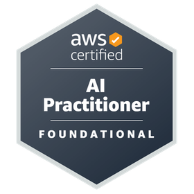</a>
  <a href="https://www.credly.com/badges/2674e4f0-828e-4047-a834-16a22c7418a8/public_url">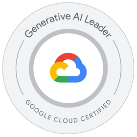</a>

 

<strong>🎓 Cloud Associate & Foundations (5)</strong>

 

  
  <a href="https://www.credly.com/badges/f3a5d593-8f1e-4fdd-9a07-43ae50fbf58b/public_url">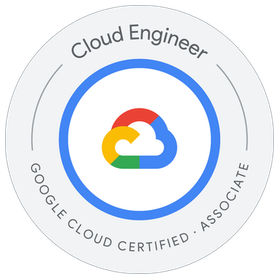</a>
  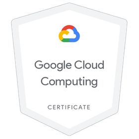
  
  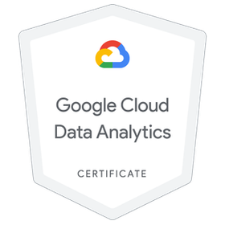

 

<strong>🛠️ DevOps & Platform Engineering (3)</strong>

 

  <a href="https://www.credly.com/badges/f21724d5-d73d-4ab5-a878-025d8ab3882d/public_url">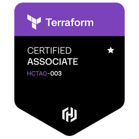</a>
  <a href="https://www.credly.com/badges/cd56e18d-ffae-4ca7-9e87-43028484f914/public_url">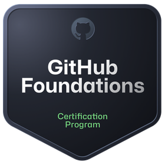</a>
  

 

<strong>📱 Enterprise Mobility Management (6)</strong>

 

  <a href="https://www.credly.com/badges/1303d496-d468-4927-b16a-f333fd5cdcfa/public_url">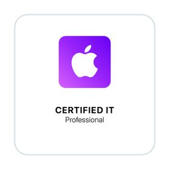</a>
  <a href="https://www.credly.com/badges/72c72dea-b8a8-4f4f-868e-22cc78f7a9cd/public_url">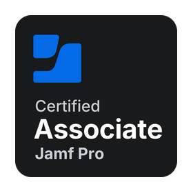</a>
  <a href="https://www.credly.com/badges/640a89c1-0ce8-4339-8a1f-90c204621965/public_url">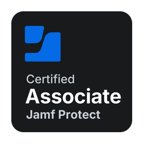</a>
  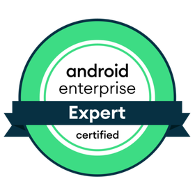
  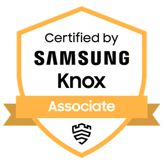
  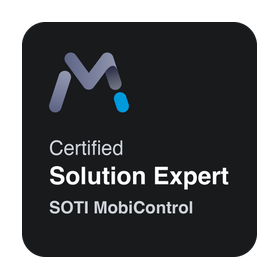

 

<strong>🔶 AWS Skill Badges (16)</strong>

 

  <a href="https://www.credly.com/badges/a5069c61-8d7c-43d2-9da8-f2299a683980/public_url">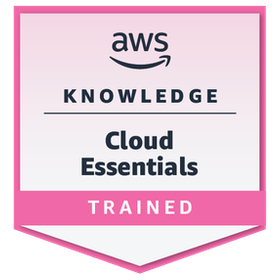</a>
  <a href="https://www.credly.com/badges/ae7c20a3-5bf5-4a2f-b52b-63da577924eb/public_url">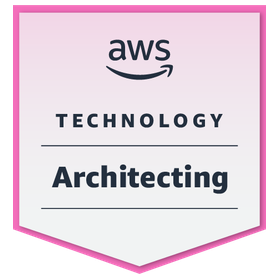</a>
  <a href="https://www.credly.com/badges/f6378385-87bb-42dc-9e37-bba9a450e143/public_url">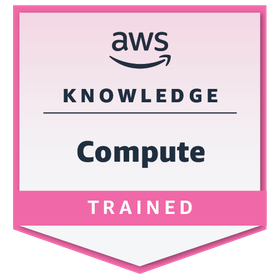</a>
  <a href="https://www.credly.com/badges/bfceee52-557e-4580-b7b5-7327c79ac0d4/public_url">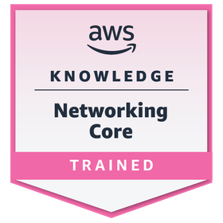</a>
  <a href="https://www.credly.com/badges/8e127bc3-b7fb-404f-b3a1-ccb3fe7db658/public_url">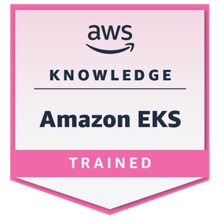</a>
  <a href="https://www.credly.com/badges/4e4d9534-8e02-4a49-9a4c-60b09cb45a2f/public_url">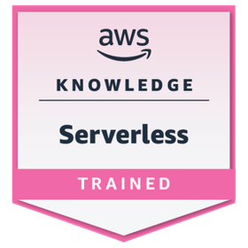</a>
  <a href="https://www.credly.com/badges/caf46b96-c418-4b05-b26b-e6d4f4807b9b/public_url">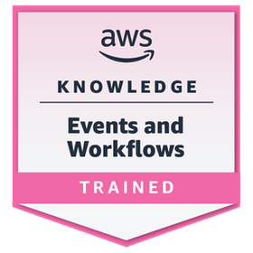</a>
  <a href="https://www.credly.com/badges/43d032ae-515c-4121-929d-a73b6a46a500/public_url">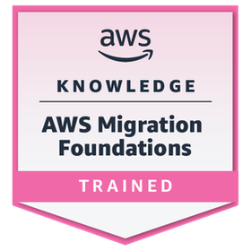</a>
   
  <a href="https://www.credly.com/badges/6a325014-61e7-4db8-af24-eaebd4b68096/public_url">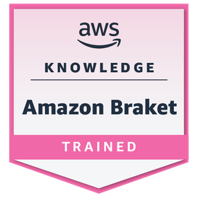</a>
  <a href="https://www.credly.com/badges/2d46cd59-28cb-4a0e-b63a-bdaeff179f25/public_url">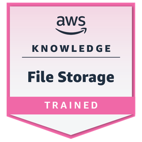</a>
  <a href="https://www.credly.com/badges/f1675f24-e41e-4da6-a534-3664a1a4231b/public_url">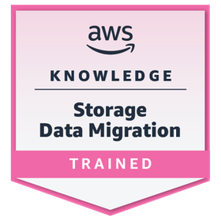</a>
  <a href="https://www.credly.com/badges/f935c4cc-f56d-49b7-9336-24eb5159535b/public_url">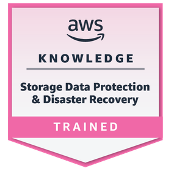</a>
  <a href="https://www.credly.com/badges/4b7efbb9-ba0d-49eb-8f34-c9bcbb3e833d/public_url">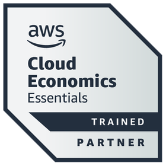</a>
  <a href="https://www.credly.com/badges/7a19ba43-25d6-4624-96c4-6533842f0c75/public_url">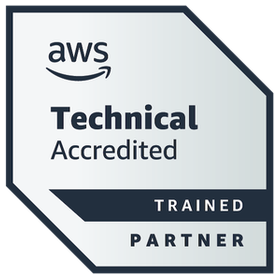</a>
  <a href="https://www.credly.com/badges/b8ca9651-fcdb-4934-9e1d-fdaca5baf1b8/public_url">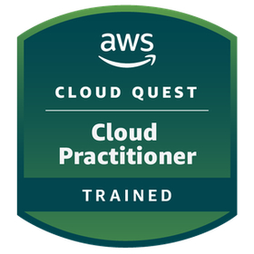</a>
  <a href="https://www.credly.com/badges/62236050-d59a-4003-88eb-3ae70779321d/public_url">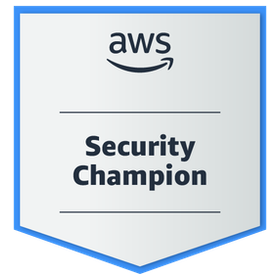</a>

 

<strong>🔷 Google Cloud Skill Badges (10)</strong>

 

  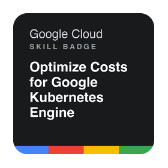
  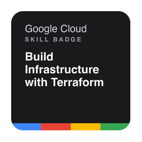
  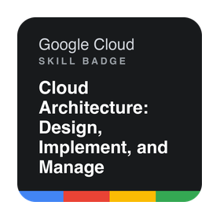
  
  
   
  
  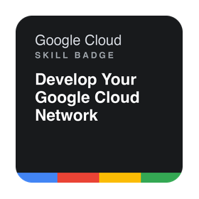
  
  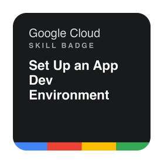
  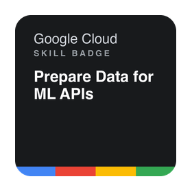

 

---

  Built with ☕ and too many VMs — <a href="https://www.linkedin.com/in/rodiellezcano">Let's connect</a>

